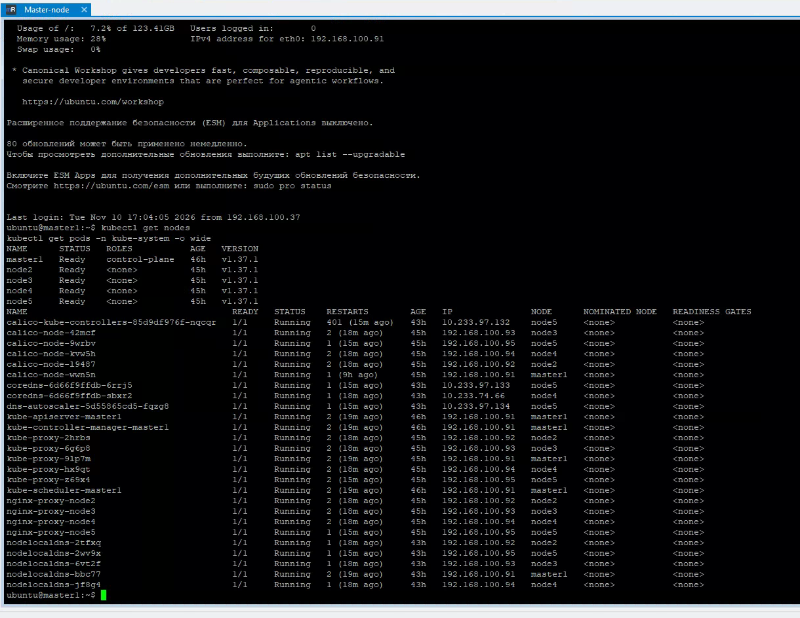
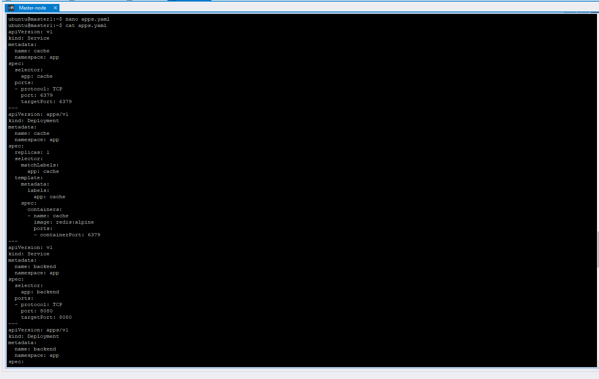
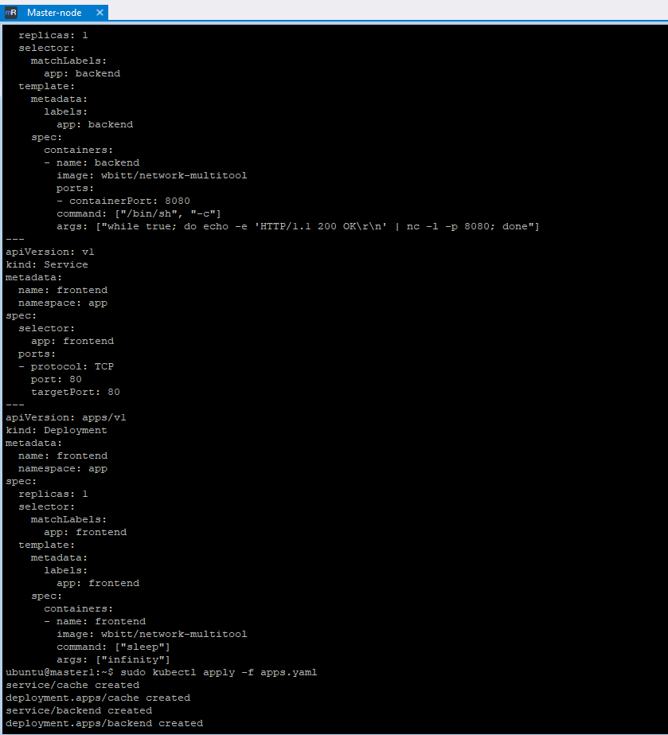
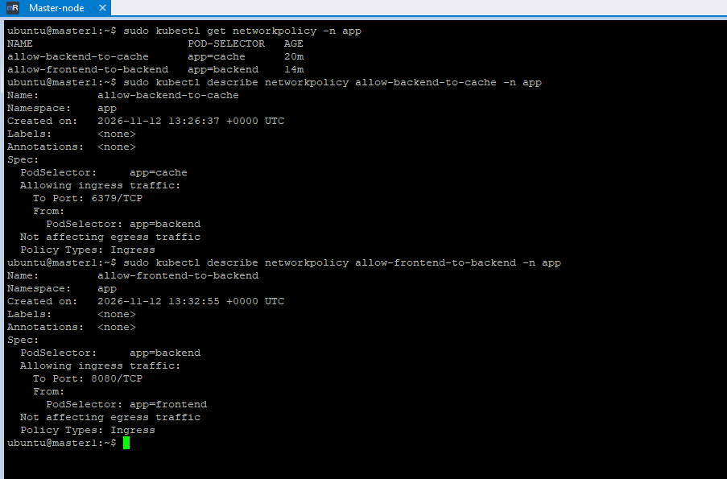
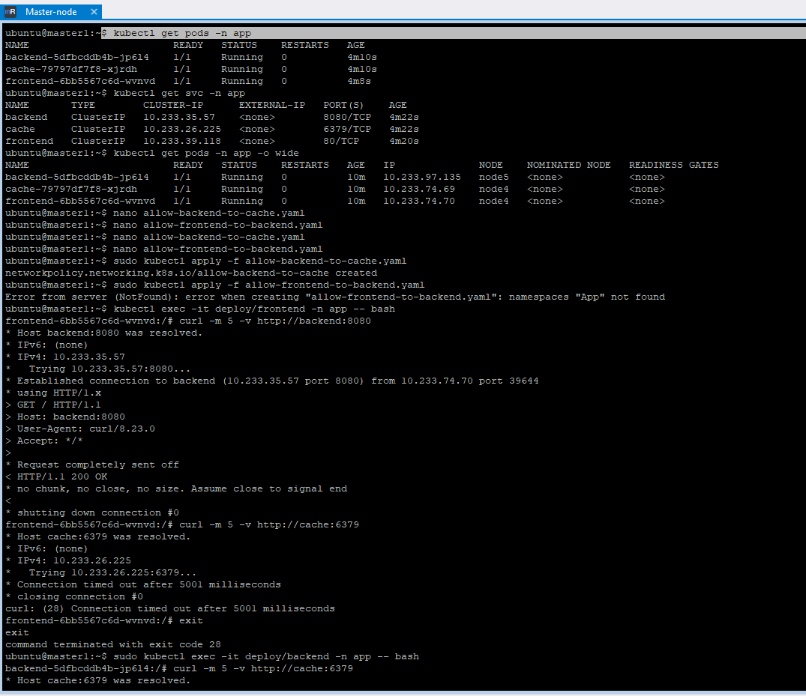
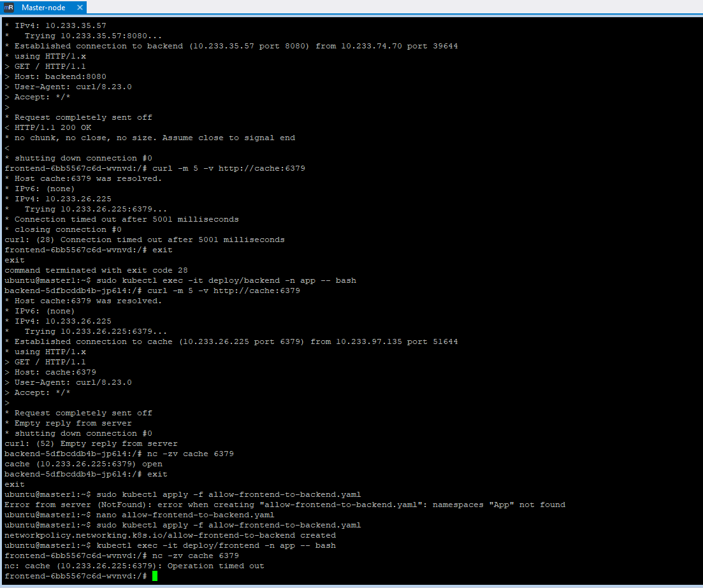

# Создать сетевую политику или несколько политик для обеспечения доступа

### 0.Кластер запущен с прошлой задачи

### 1. Создаём namespace App и приложения

- kubectl create namespace app

Используем network-multitool (он умеет отвечать на HTTP и делать curl/nc)

-kubectl get pods -n app -o wide

### 2.Создать политики, чтобы обеспечить доступ frontend -> backend -> cache. Другие виды подключений должны быть запрещены.

Политика 1: Запрет всего входящего трафика (Default Deny Ingress)

default-deny-ingress.yaml

Политика 2: Запрет всего исходящего трафика (Default Deny Egress)

default-deny-egress.yaml

Шаг 4: Разрешение доступа (Frontend -> Backend -> Cache)

Политика 3: Разрешить Backend принимать трафик ТОЛЬКО от Frontend

allow-backend-from-frontend.yaml

Политика 4: Разрешить Cache принимать трафик ТОЛЬКО от Backend

allow-cache-from-backend.yaml
 
Политика 5: Разрешить Frontend исходящий трафик только к Backend

allow-frontend-to-backend.yaml

Применяем политики

### 4.Демонстрация (Тестирование)

IP-адреса подов:
kubectl get pods -n app -o wide

1. Проверка разрешенного доступа (Frontend -> Backend): Заходим в frontend:

kubectl exec -it deploy/frontend -n app -- bash
Внутри пода запрос к сервису backend

curl -m 5 -v http://backend:8080
Ожидаемый результат: HTTP/1.1 200 OK

Проверка разрешенного доступа (Backend -> Cache): в frontend обратиться к cache 

curl -m 5 -v http://cache:6379
Ожидаемый результат: timeout / Connection refused

Теперь проверим из backend (разрешено):

kubectl exec -it deploy/backend -n app -- bash
curl -m 5 -v http://cache:6379
Ожидаемый результат: Redis ответ или ошибка протокола. 

Лучше проверить через nc:
nc -zv cache 6379
Ожидаемый результат: Connection to cache 6379 port [tcp/redis] succeeded!

Проверка запрещенного доступа (Frontend -> Cache напрямую): Снова в frontend:

nc -zv cache 6379
Ожидаемый результат: nc: connect to cache port 6379 (tcp) failed: Connection timed out

