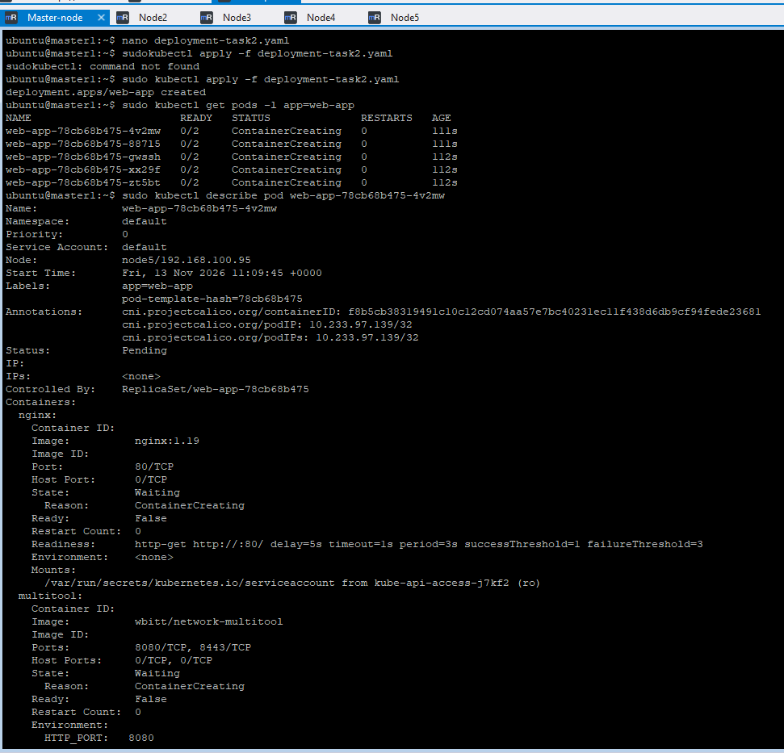
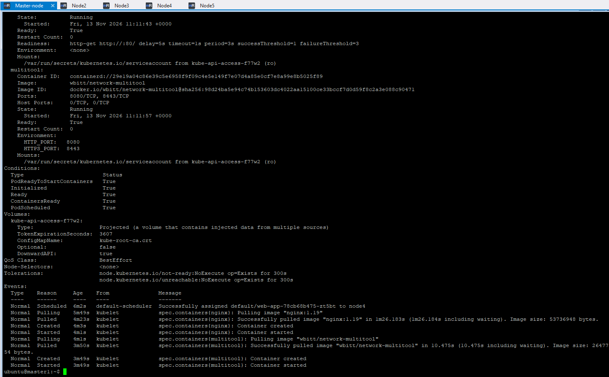
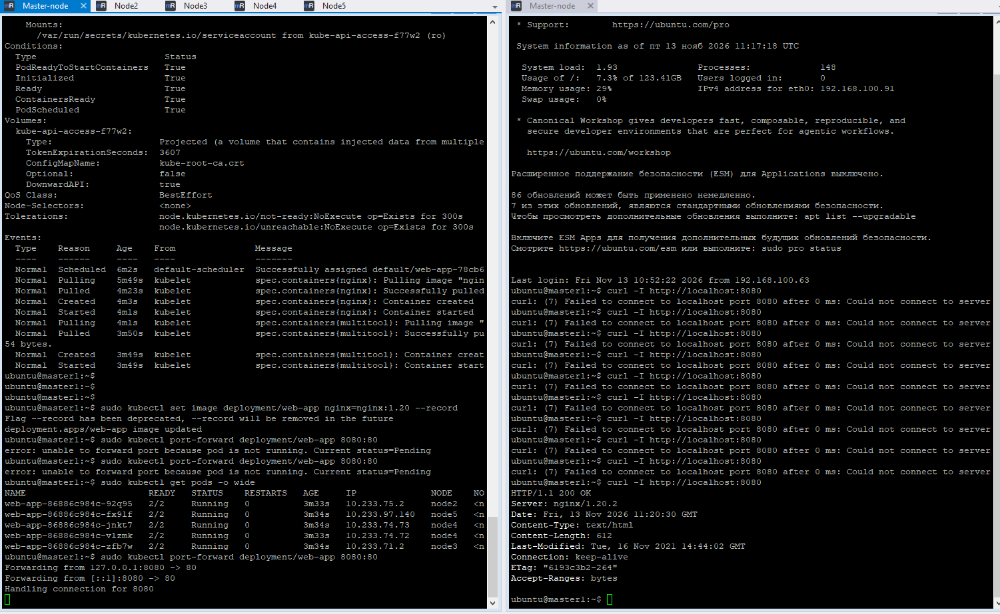
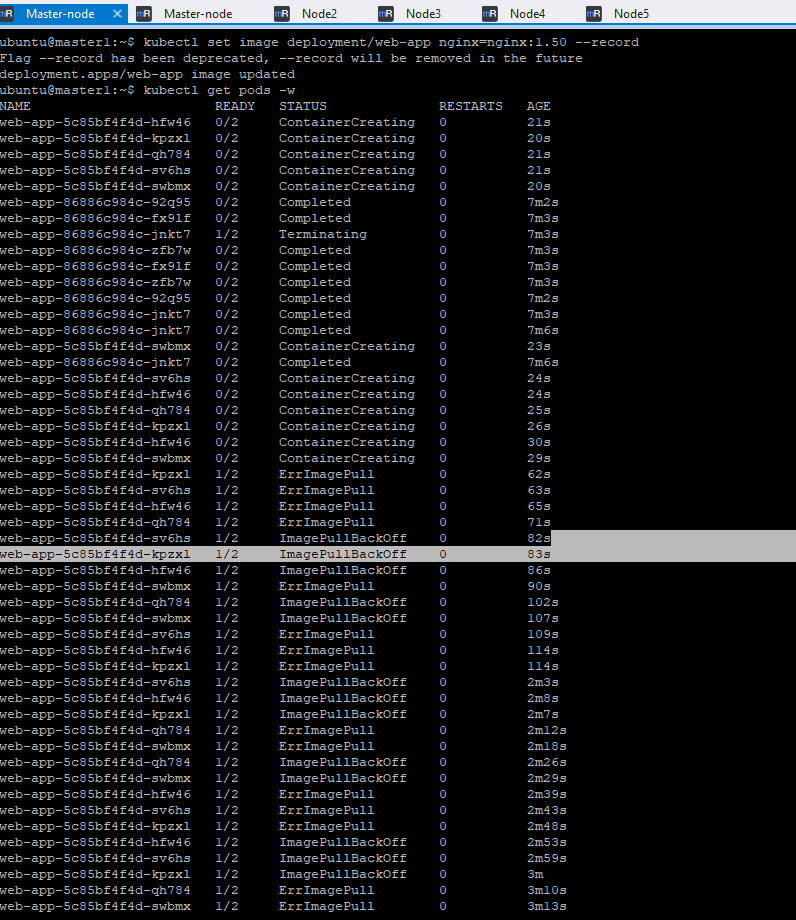
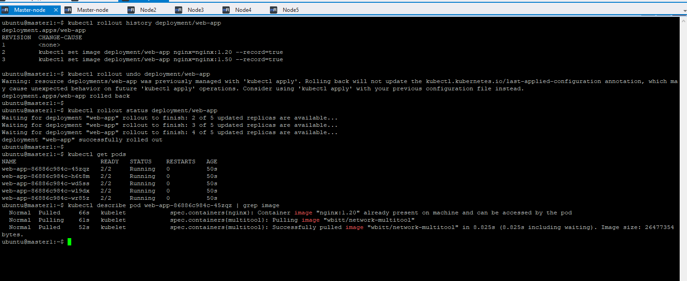

## Задание 1.Выбрать стратегию обновления приложения и описать ваш выбор

Имеется приложение, состоящее из нескольких реплик, которое требуется обновить.
Ресурсы, выделенные для приложения, ограничены, и нет возможности их увеличить.
Запас по ресурсам в менее загруженный момент времени составляет 20%.
Обновление мажорное, новые версии приложения не умеют работать со старыми.
Вам нужно объяснить свой выбор стратегии обновления приложения.

### Для описанной ситуации наиболее подходящей стратегией обновления является Rolling Update 

Cтратегии Blue-Green или Canary не подходят из-за жесткого ограничения ресурсов (невозможность развернуть вторую полную копию приложения):

Blue-Green подразумевает наличие двух идентичных окружений (Production и Staging), но у нас нет свободных ресурсов для дублирования окружения.

Canary требует выделения части ресурсов (например, 10-20% реплик) под новую версию на длительный срок. 20% у нас есть вроде,  но так как обновление мажорное, то несовместимо со старой версией. Если запустить 1 под новой версии и 4 пода старой, они будут конфликтовать.

Recreate прдполагает более длительный простой сервисов (остановить все старые и запустить все новые)

================

## Задание 2. Обновить приложение.

#### 1: Создание Deployment (Nginx 1.19 + Multitool)

Создадим файл deployment-task2.yaml. Важные детали:
Проверим что в каждом из 5 подов запущено 2 контейнера (kubectl describe pod <pod-name>).

#### 2: Обновление до Nginx 1.20 (минимальное время)

kubectl set image deployment/web-app nginx=nginx:1.20 --record
Проверка доступности: Псоздадим временный port-forward к одному из подов чтобы убедиться что Nginx отвечает:
kubectl port-forward deployment/web-app 8080:80
+ в другом терминале curl -I http://localhost:8080

#### 3: Обновление до несуществующей версии (1.50)

Применим образ 1.50 которого нет в реестре.
проверка kubectl get pods -w

#### 4: Откат (Rollback)

Посмотреть историю, выполнить откат:

