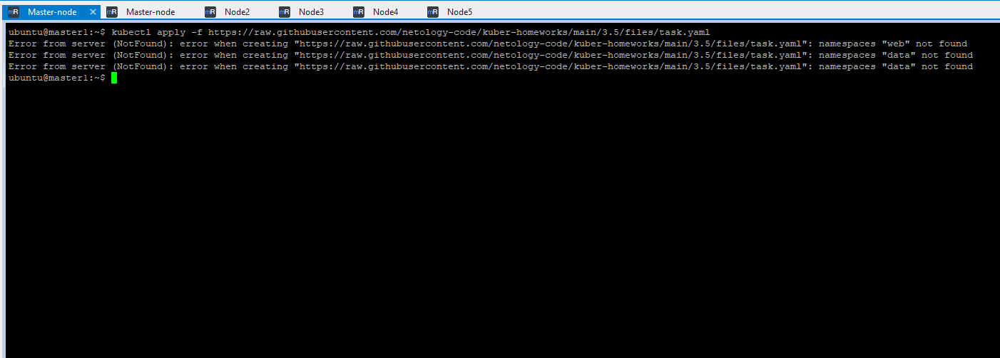
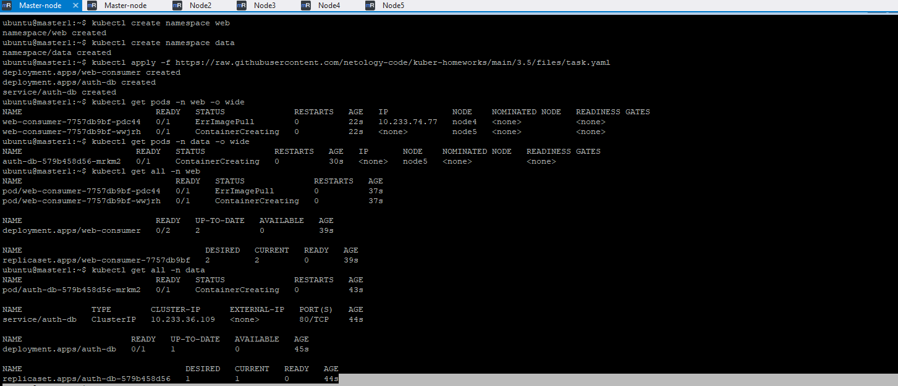
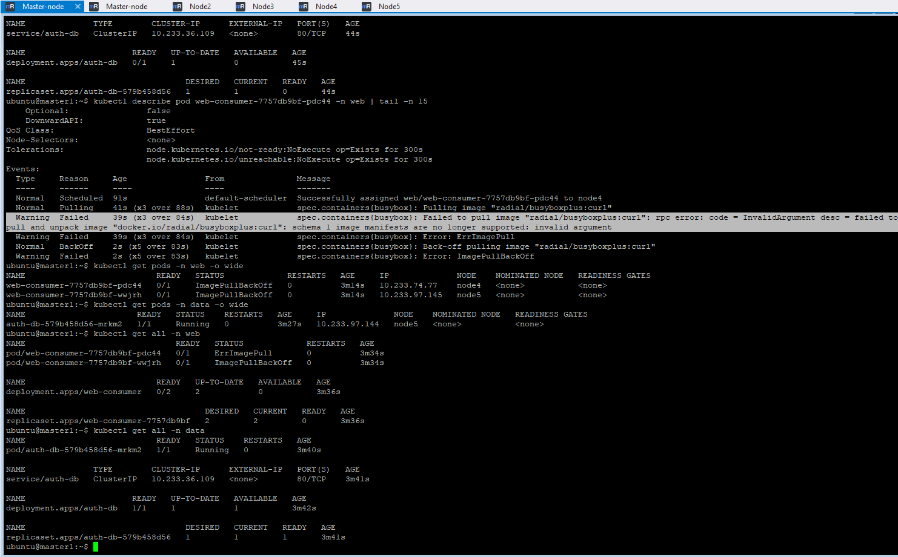
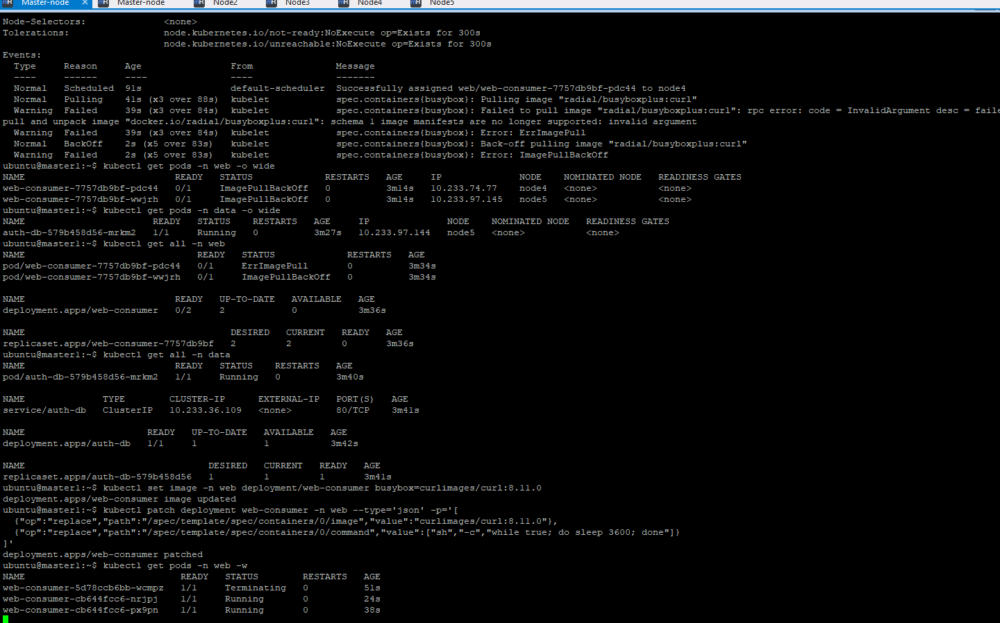
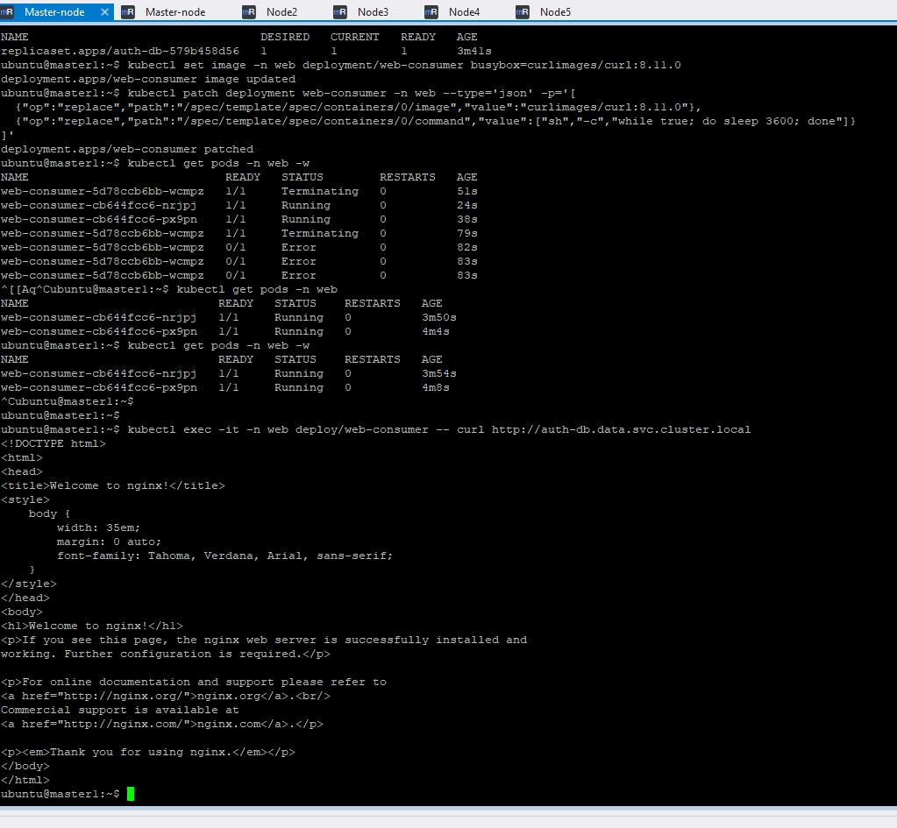

# Устранить неисправности при деплое приложения.

## Задание. При деплое приложение web-consumer не может подключиться к auth-db. Необходимо это исправить

Установить приложение по команде:
Выявить проблему и описать.

### Проблема 1

 

#### Причина 1

Не созданы пространства namespaces "web" и "data",

#### Решение 1 

Создадим сами и запустим снова.

### Проблема 2 :

При повторном запуске видим ошибку ErrImagePull 

 

посмотрим под подробнее:

 

#### Причина 2:

 образ radial/busyboxplus:curl использует устаревший формат манифеста (schema 1), а новый containerd его больше не поддерживает:

#### Решение 2: заменить образ на совместимый
и пропатчить деплоймент — вместо radial/busyboxplus:curl взять живой аналог с curl внутри:

###Продемонстрировать, что проблема решена.

