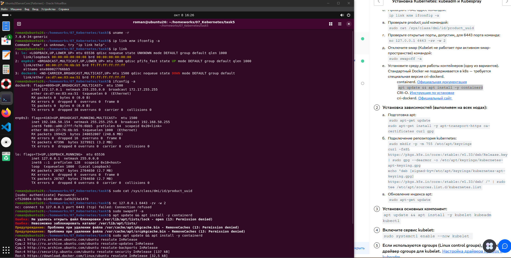
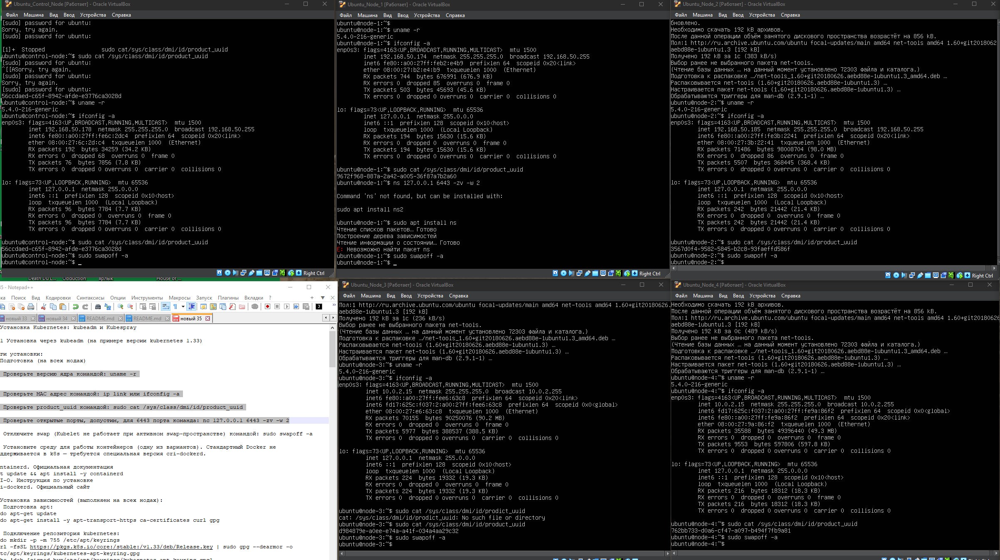
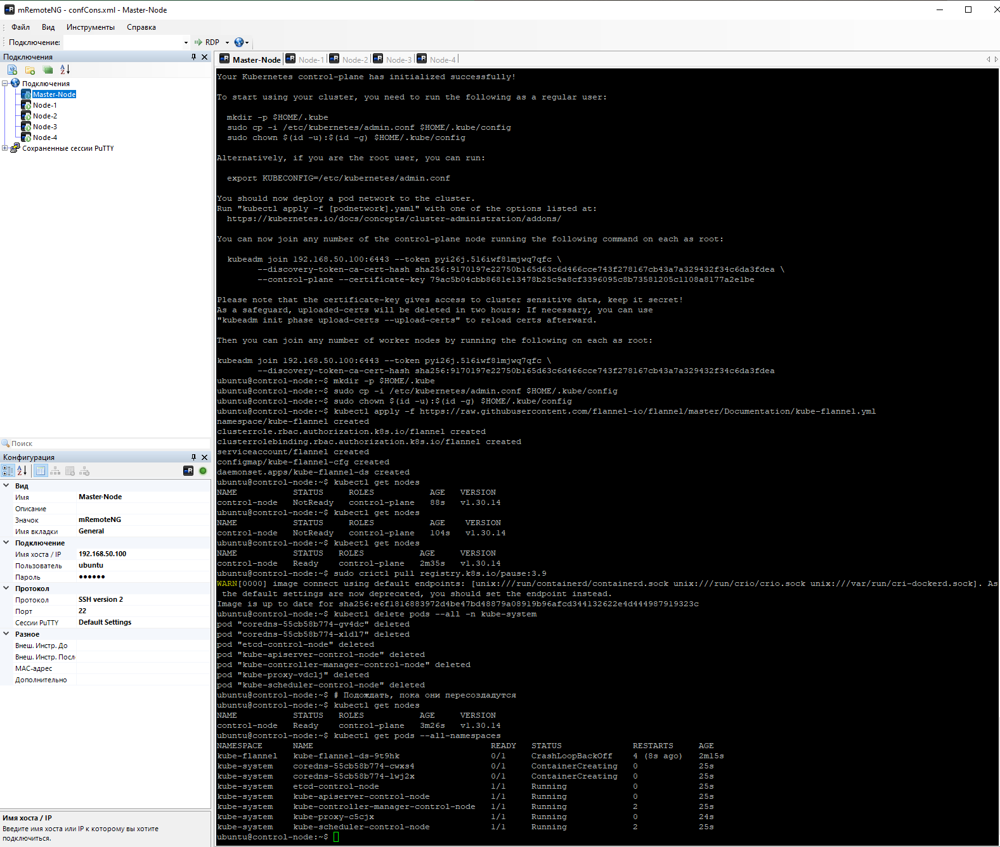
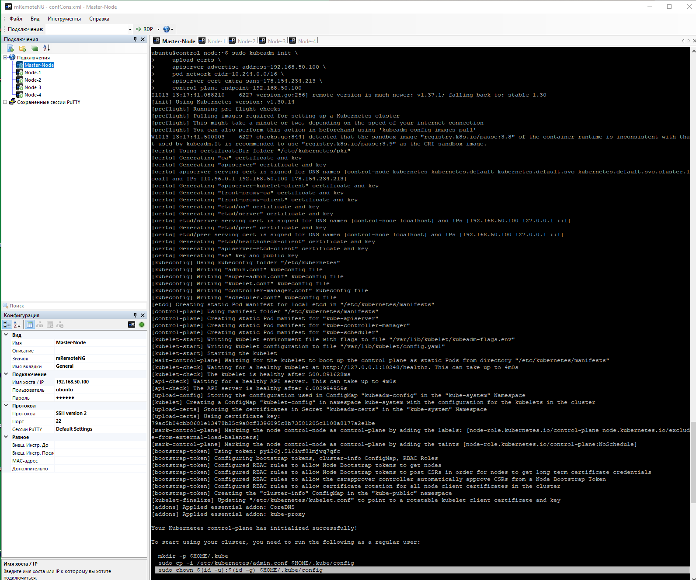
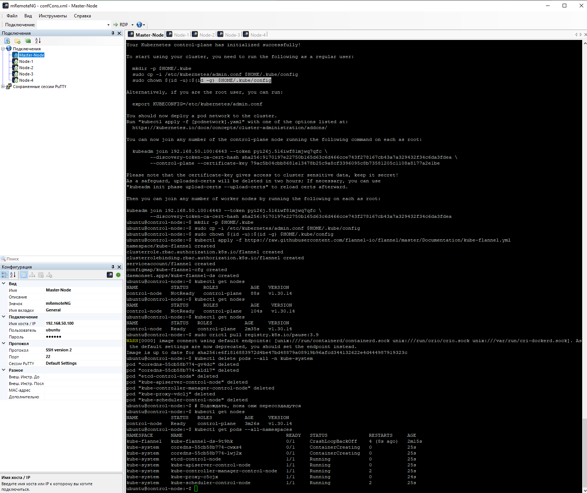
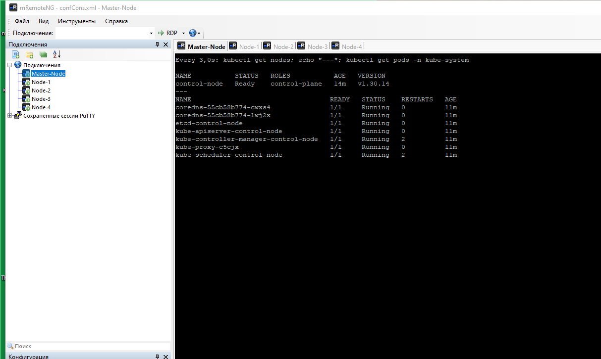
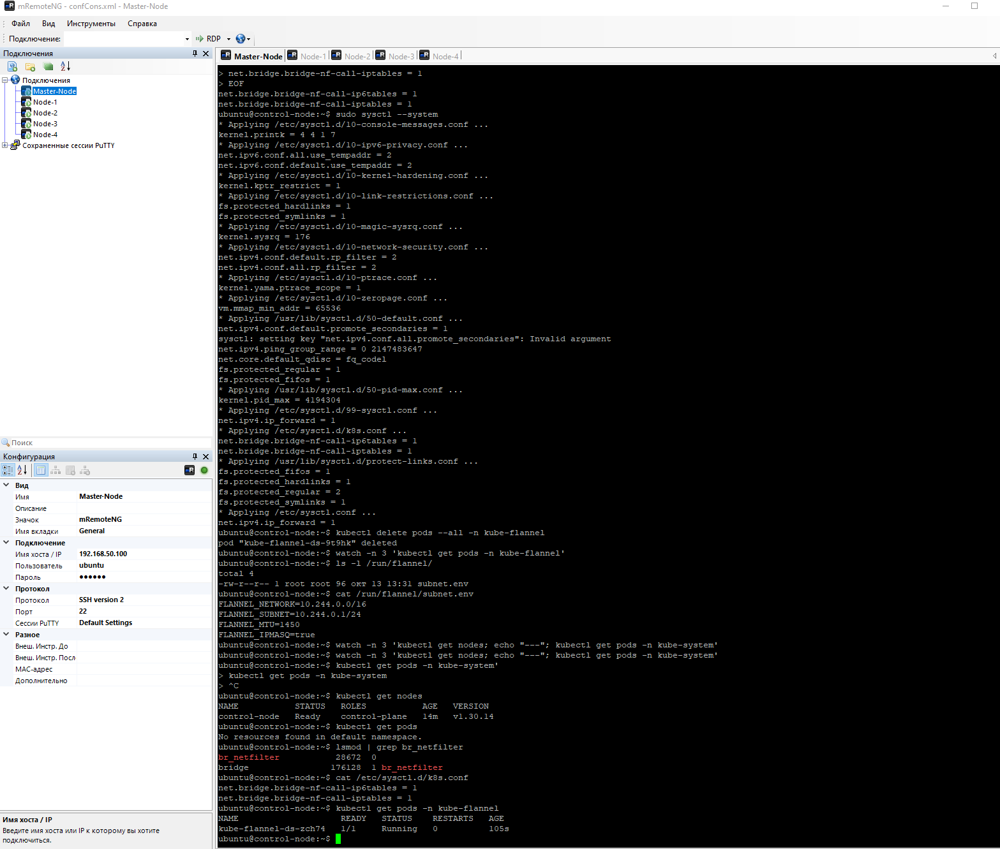
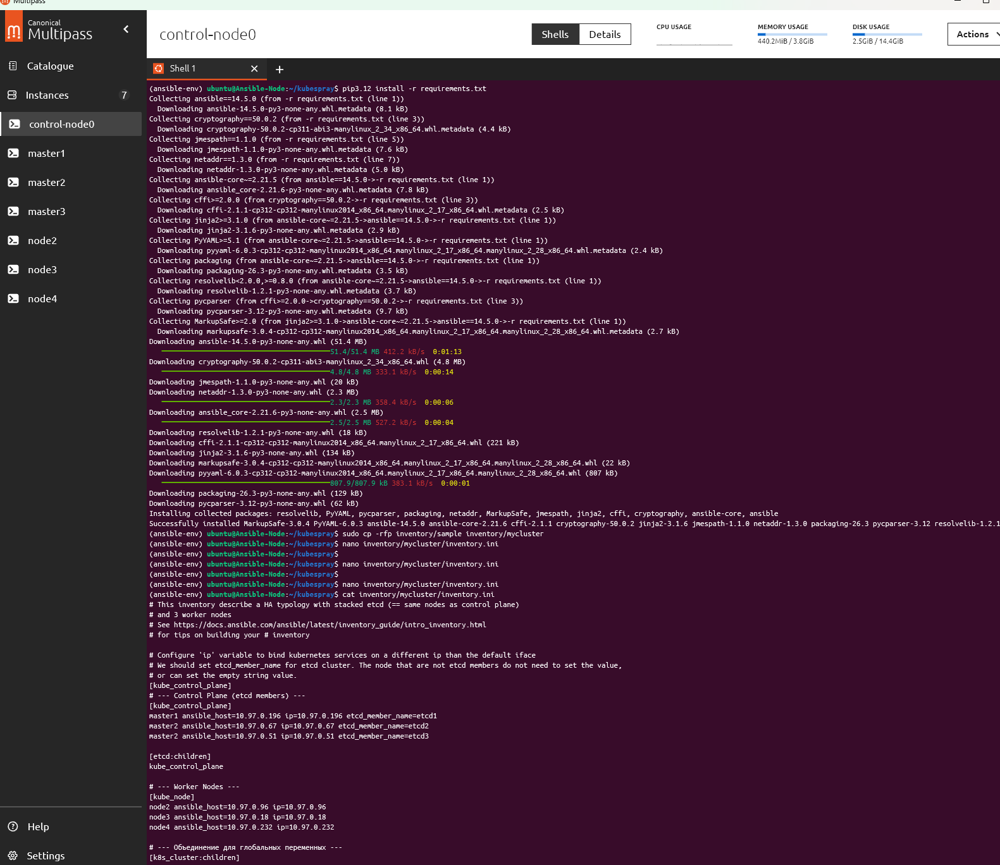
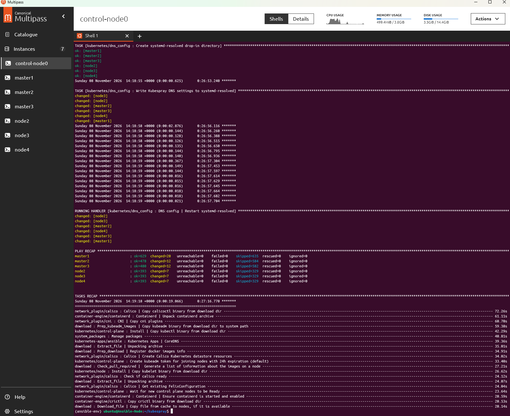
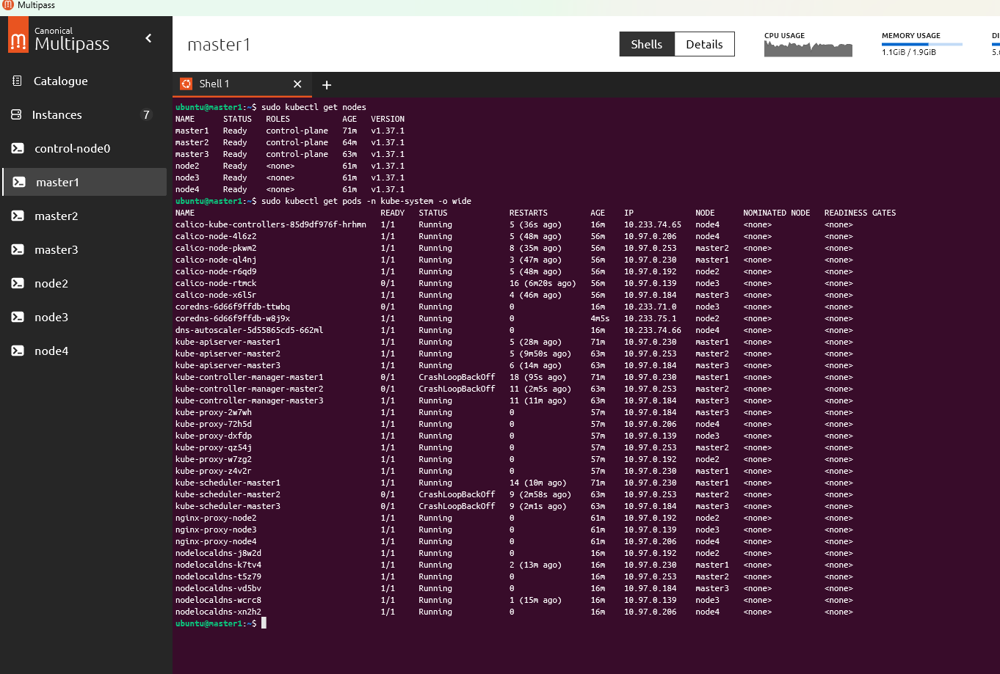

# Установка Kubernetes: kubeadm и Kubespray

## Выбираем вариант №1: Установка через kubeadm 

#### 1.1 Подготовка на всех нодах:  

#### 1.2 Установка основных компонент:

#### 1.3 Инициализация master-ноды:

#### 1.4 Токен и подключение worker-нод:

#### 1.5 kubectl get pods -n kube-system (или -n calico-system

#### 1.6 br_netfilter

============================
============================
============================

## Вариант №2 Пробуем также установку через Kubespray с тремя мастер-нодами.

#### 2.1 Подготовка

Alpine Linux в качестве нод.
Установка через pip + виртуальное окружение 
 python3 -m venv ~/ansible-env source ~/ansible-env/bin/activate

#### 2.2 Клонируем репозиторий ставим зависимости, настраиваем инвентарь:

 

#### 2.3 Запускаем установку: ansible-playbook -i inventory/mycluster/inventory.ini -b cluster.yml

После продолжительного времени и многих перезапусков наконец-то успешно развернулось:

#### 2.4 

Ноды готовы, некоторые поды ещё в процессе (так как мало оперативной памяти выделил для виртуальных машин):

 

