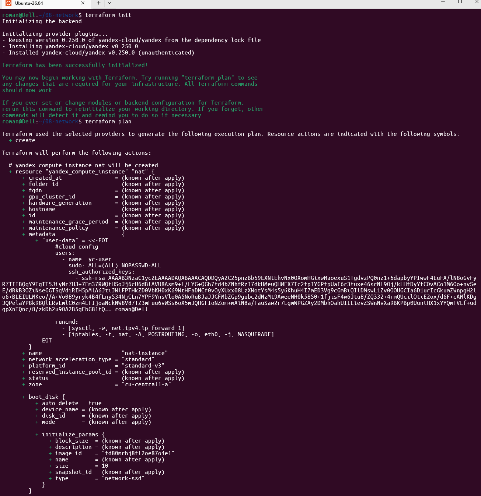
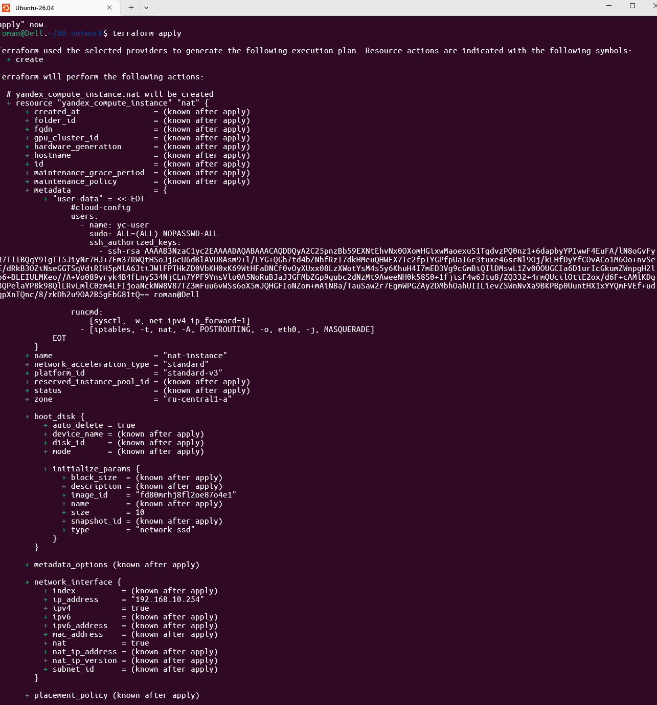
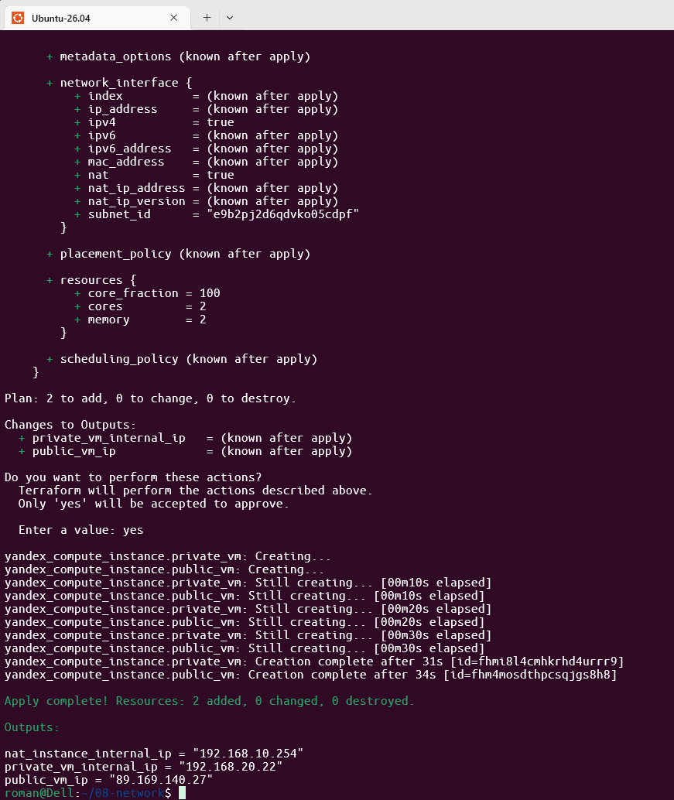
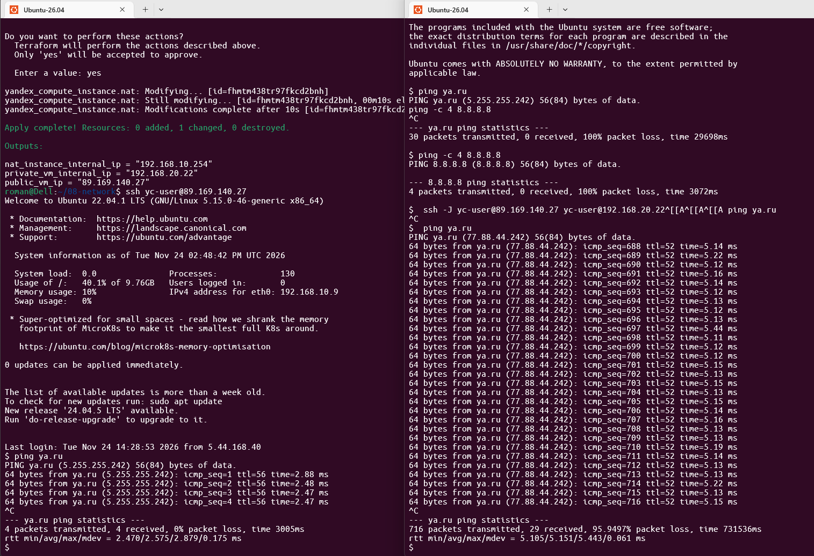
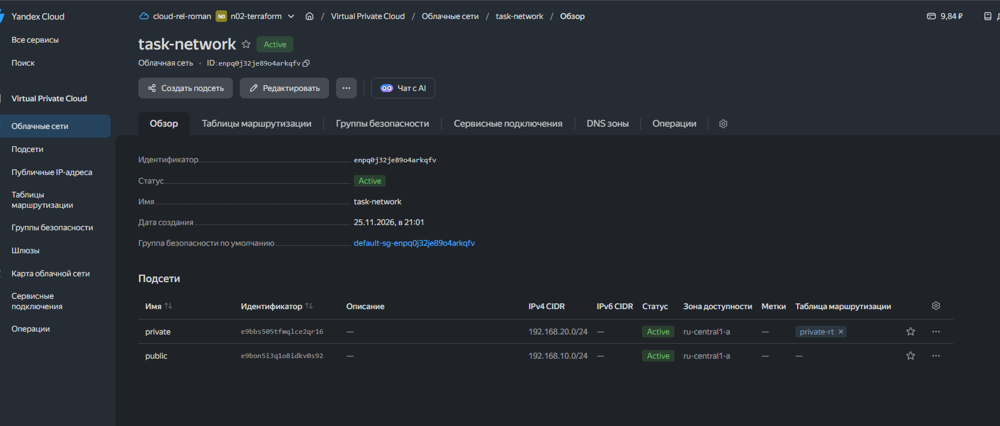
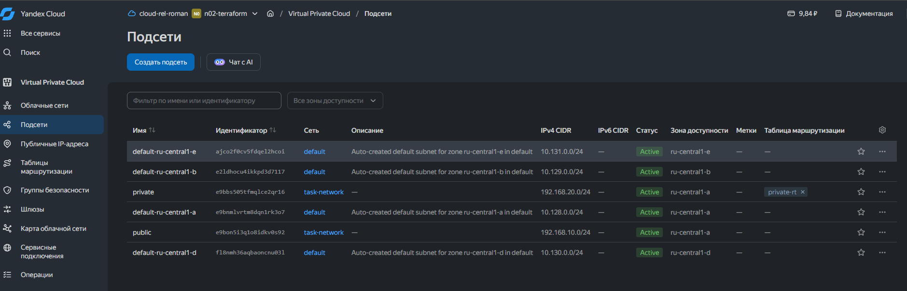
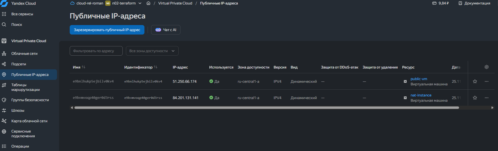
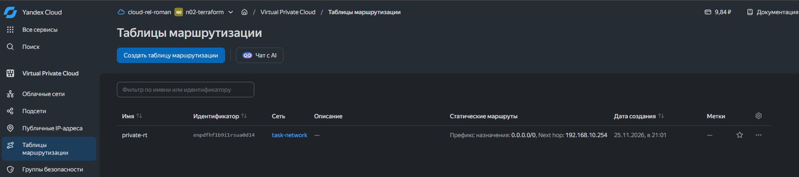
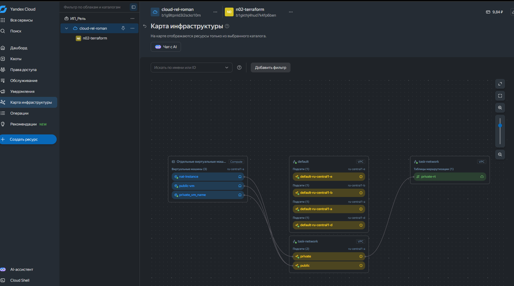

# Задание 1. Yandex Cloud

### Скриншоты применения Ansible  и проверки доступа в Интернет.

### Скриншоты из  Yandex Cloud

P.S. Скриншоты из Yandex Cloud делал посте второго запуска, поэтому IP-адреса отличаются.
